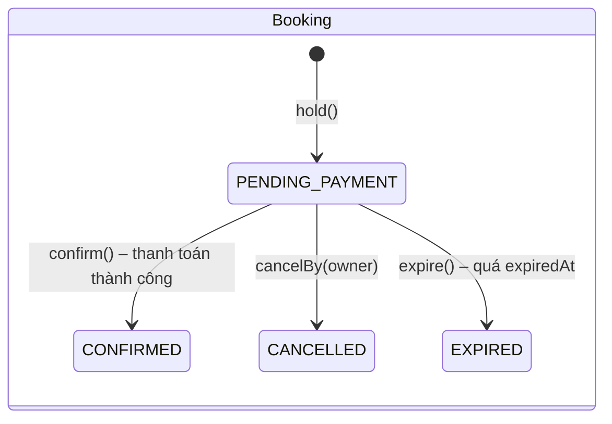
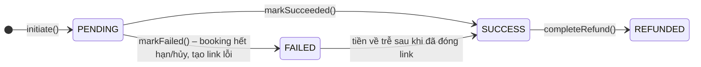
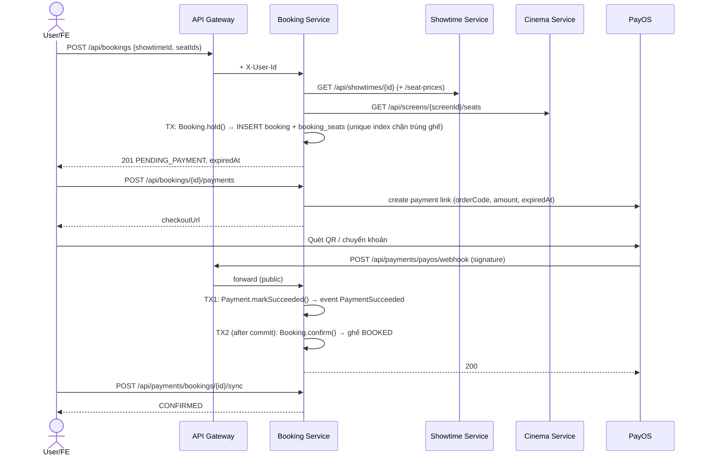

# Booking API

Booking Service giữ ghế theo suất chiếu, tạo booking chờ thanh toán, thanh toán qua **PayOS** và xác nhận / hết hạn / hoàn tiền.
Service được viết theo **Clean Architecture** – xem [BOOKING_ARCHITECTURE.md](BOOKING_ARCHITECTURE.md) để hiểu cách tổ chức code.

- Port local: `8085` (`SERVER_PORT`). Qua gateway: `http://localhost:8080`.
- Database: `booking_db` (MySQL, Flyway `V1__init_booking_schema.sql`).
- Mọi response bọc trong `ApiResponse` của module `common` (`status`, `message`, `data`, `timestamp`).
- Định danh người gọi: gateway xác thực JWT rồi gửi header `X-User-Id`, `X-User-Roles`. Gọi thẳng service (không qua gateway) phải tự gửi 2 header này.

## 1. Danh sách endpoint

| Method | Path | Quyền | Mô tả | Thành công |
| --- | --- | --- | --- | --- |
| GET | `/api/bookings/showtimes/{showtimeId}/seats` | Public | Sơ đồ ghế + trạng thái + giá theo suất chiếu | 200 |
| POST | `/api/bookings` | Đăng nhập | Giữ ghế, tạo booking `PENDING_PAYMENT` | 201 + `Location` |
| GET | `/api/bookings?status=&showtimeId=&userId=&code=&from=&to=&page=0&size=10` | ADMIN | Danh sách và tìm kiếm mọi booking (mới nhất trước) | 200 |
| GET | `/api/bookings/me?page=0&size=10` | Đăng nhập | Lịch sử booking của tôi (mới nhất trước) | 200 |
| GET | `/api/bookings/{id}` | Chủ booking / ADMIN | Chi tiết booking + lần thanh toán gần nhất | 200 |
| POST | `/api/bookings/{id}/cancel` | Chủ booking | Hủy booking đang chờ thanh toán, nhả ghế | 200 |
| PUT | `/api/bookings/{id}/combos` | Chủ booking | Thay toàn bộ combo của booking, tính lại tổng tiền | 200 |
| POST | `/api/bookings/{id}/vouchers` | Chủ booking | Áp voucher, tính lại tổng tiền | 200 |
| DELETE | `/api/bookings/{id}/vouchers/{voucherId}` | Chủ booking | Gỡ voucher, trả lại lượt dùng | 200 |
| POST | `/api/bookings/{id}/payments` | Chủ booking | Tạo (hoặc lấy lại) link thanh toán PayOS. Đơn 0đ được xác nhận luôn | 200 |
| POST | `/api/payments/bookings/{bookingId}/sync` | Chủ booking | Hỏi PayOS trạng thái thật rồi trả booking | 200 |
| POST | `/api/payments/payos/webhook` | Public (verify chữ ký) | PayOS báo kết quả thanh toán | 200 |
| GET | `/api/payments/refunds?status=PENDING` | ADMIN | Danh sách yêu cầu hoàn tiền | 200 |
| POST | `/api/payments/refunds/{id}/complete` | ADMIN | Đánh dấu đã hoàn tiền thủ công | 200 |
| GET | `/api/combos` | Public | Combo đang bán | 200 |
| GET | `/api/combos/all` | ADMIN | Mọi combo, gồm cả combo đã ngừng bán | 200 |
| POST | `/api/combos` | ADMIN | Tạo combo | 201 + `Location` |
| PUT | `/api/combos/{id}` | ADMIN | Sửa tên, mô tả, giá | 200 |
| POST | `/api/combos/{id}/activate` | ADMIN | Mở bán lại | 200 |
| POST | `/api/combos/{id}/deactivate` | ADMIN | Ngừng bán | 200 |
| GET | `/api/vouchers` | ADMIN | Danh sách voucher, phân trang | 200 |
| GET | `/api/vouchers/{id}` | ADMIN | Chi tiết voucher | 200 |
| POST | `/api/vouchers` | ADMIN | Tạo voucher | 201 + `Location` |
| PUT | `/api/vouchers/{id}` | ADMIN | Sửa voucher chưa có chủ | 200 |
| POST | `/api/vouchers/{id}/activate` | ADMIN | Bật voucher | 200 |
| POST | `/api/vouchers/{id}/deactivate` | ADMIN | Tắt voucher | 200 |
| POST | `/api/vouchers/{id}/assign` | ADMIN | Gán voucher cho một tài khoản | 200 |
| GET | `/api/vouchers/me` | Đăng nhập | Voucher của tôi | 200 |
| POST | `/api/vouchers/claim` | Đăng nhập | Nhập mã để nhận voucher | 200 |

### Mã lỗi chung

| HTTP | Khi nào |
| --- | --- |
| 400 | Body/param sai, vi phạm quy tắc domain (`DomainException`: 0 ghế, trùng ghế, quá `BOOKING_MAX_SEATS`, ghế không thuộc phòng...), webhook thiếu hoặc sai chữ ký |
| 401 | Thiếu / sai `X-User-Id` (chưa đăng nhập) |
| 403 | Endpoint ADMIN nhưng user không có role `ADMIN` |
| 404 | Booking không tồn tại **hoặc không thuộc về bạn** (không lộ id của người khác), showtime không tồn tại |
| 409 | Ghế đã có người giữ/đặt, ghế bảo trì, booking không còn ở trạng thái cho phép (đã hết hạn, đã xác nhận...), suất chiếu đã bắt đầu/bị hủy |
| 502 | PayOS lỗi / chưa cấu hình khi tạo link |
| 503 | showtime-service hoặc cinema-service không phản hồi |

## 2. Chi tiết endpoint

### 2.1 Sơ đồ ghế

`GET /api/bookings/showtimes/{showtimeId}/seats`

Ghép sơ đồ ghế vật lý (cinema-service) với trạng thái ghế thực tế trong `booking_db`.
`status`: `AVAILABLE` | `HELD` (đang có người giữ chờ thanh toán) | `BOOKED` | `UNAVAILABLE` (ghế không `ACTIVE` bên cinema).
Giá = giá theo loại ghế của suất chiếu nếu showtime-service có, ngược lại = `basePrice` của suất chiếu.

```json
{
  "status": 200,
  "message": "Seat map retrieved successfully",
  "data": {
    "showtimeId": 15,
    "screenId": 3,
    "seats": [
      {"seatId": 101, "rowCode": "A", "seatNumber": 1, "seatTypeId": 1, "price": 90000, "status": "AVAILABLE"},
      {"seatId": 102, "rowCode": "A", "seatNumber": 2, "seatTypeId": 2, "price": 150000, "status": "HELD"}
    ]
  }
}
```

### 2.2 Giữ ghế – tạo booking

`POST /api/bookings`

| Field | Kiểu | Ràng buộc |
| --- | --- | --- |
| `showtimeId` | number | bắt buộc, > 0 |
| `seatIds` | number[] | 1..20 phần tử, mỗi id > 0, không trùng; tối đa `BOOKING_MAX_SEATS` (mặc định 8) |

```bash
curl -X POST http://localhost:8080/api/bookings \
  -H "Authorization: Bearer $TOKEN" -H "Content-Type: application/json" \
  -d '{"showtimeId": 15, "seatIds": [101, 102]}'
```

Kiểm tra: suất chiếu phải `SCHEDULED` và chưa bắt đầu; ghế phải thuộc phòng chiếu và `ACTIVE`; ghế chưa bị giữ/đặt.
Booking giữ ghế trong `BOOKING_HOLD_TTL` (mặc định `PT5M`), hết hạn lúc `expiredAt`.

```json
{
  "status": 201,
  "message": "Seats held successfully",
  "data": {
    "id": 12,
    "bookingCode": "BK270120180000X7K2QD",
    "userId": 7,
    "showtimeId": 15,
    "status": "PENDING_PAYMENT",
    "subtotal": 240000.00,
    "discountAmount": 0.00,
    "totalAmount": 240000.00,
    "bookingTime": "2027-01-20T18:00:00",
    "expiredAt": "2027-01-20T18:05:00",
    "ticket": {
      "movieTitle": "Dune",
      "moviePosterUrl": "https://example.com/dune.jpg",
      "startTime": "2027-01-21T19:00:00",
      "endTime": "2027-01-21T21:30:00",
      "cinemaName": "Rạp Hà Nội",
      "screenName": "Phòng chiếu 1"
    },
    "seats": [
      {"seatId": 101, "rowCode": "A", "seatNumber": 1, "seatTypeName": "Ghế thường", "price": 90000.00, "status": "HELD"},
      {"seatId": 102, "rowCode": "C", "seatNumber": 1, "seatTypeName": "Ghế VIP", "price": 150000.00, "status": "HELD"}
    ],
    "combos": [],
    "vouchers": [],
    "payment": null
  }
}
```

Lỗi: `409 "One or more selected seats are no longer available"` khi có người giữ ghế trước.

**Thông tin vé là bản sao lúc giữ ghế.** `ticket`, `rowCode`, `seatNumber`, `seatTypeName` và tên combo không đổi theo danh mục về sau, kể cả khi phim đổi tên hay suất chiếu dời giờ. Vì vậy mọi API đọc booking không gọi service khác, và vẫn chạy khi các service đó lỗi.

Khi giữ ghế, nếu không lấy được thông tin phim, rạp, phòng hoặc loại ghế thì trả 503 và không tạo booking.

Booking tạo trước khi có tính năng này trả `ticket: null`, các field ghế mới cũng `null`. `moviePosterUrl` có thể `null` nếu phim chưa có poster.

### 2.3 Lịch sử, chi tiết, hủy

- `GET /api/bookings/me?page=0&size=10` – `size` 1..100, trả `PageResponseDTO` (`data.data` là danh sách `BookingView`).
- `GET /api/bookings/{id}` – `BookingView`, trường `payment` là lần thanh toán mới nhất (hoặc `null`).
- `POST /api/bookings/{id}/cancel` – chỉ khi `PENDING_PAYMENT`. Ghế được nhả ngay; link PayOS đang mở bị hủy.

### 2.4 Tạo link thanh toán PayOS

`POST /api/bookings/{id}/payments` (không có body)

- Chỉ khi booking `PENDING_PAYMENT` và chưa quá `expiredAt`.
- Nếu đã có link đang chờ thanh toán → trả lại link cũ (gọi nhiều lần không tạo link mới).
- `orderCode = bookingId * 100 + số lần thử` (tối đa 99 lần), link PayOS hết hạn cùng lúc với booking.
- Voucher đã qua ngày cuối được gỡ trước khi tạo link, nên số tiền có thể cao hơn lúc khách áp mã. Link đã mở thì giữ giá.
- Voucher trả hết tiền (`totalAmount` = 0): booking chuyển `CONFIRMED` ngay, không tạo link và không có dòng thanh toán. Response khi đó:

```json
{
  "status": 200,
  "message": "Booking confirmed, vouchers cover the whole amount",
  "data": {"id": null, "bookingId": 12, "orderCode": null, "provider": null, "amount": 0.00,
           "status": "NOT_REQUIRED", "checkoutUrl": null, "paidAt": null}
}
```

Booking đó có `payment: null`. FE kiểm tra `status` để không redirect sang PayOS.

```json
{
  "status": 200,
  "message": "Payment link created successfully",
  "data": {
    "id": 30,
    "bookingId": 12,
    "orderCode": 1201,
    "provider": "PAYOS",
    "amount": 240000.00,
    "status": "PENDING",
    "checkoutUrl": "https://pay.payos.vn/web/2f3a...",
    "paidAt": null
  }
}
```

Frontend redirect người dùng tới `checkoutUrl`. Sau khi PayOS redirect về `PAYOS_RETURN_URL`, **không tin query string** – gọi
`POST /api/payments/bookings/{bookingId}/sync` (hoặc poll `GET /api/bookings/{id}`) để lấy trạng thái thật.

### 2.5 Webhook PayOS

`POST /api/payments/payos/webhook` – PayOS gọi, không có JWT. Service verify `signature` (HMAC-SHA256 bằng `PAYOS_CHECKSUM_KEY`).

- Thiếu `data`, thiếu `signature` hoặc chữ ký sai → `400`.
- Chữ ký đúng → luôn `200` (kể cả `orderCode` lạ, ví dụ request test khi PayOS xác minh webhook URL).
- Idempotent: PayOS gửi lại nhiều lần không làm thay đổi kết quả.

### 2.6 Hoàn tiền (ADMIN)

**Chính sách:** không hoàn tiền cho khách đã mua vé. Khi cần bù cho khách, dùng hình thức trong hệ thống như voucher hoặc điểm.

Bảng `refunds` chỉ dùng cho **lỗi phía hệ thống**, khi tiền đã về nhưng không thể xuất vé:

- Tiền về sau khi booking đã `EXPIRED` hoặc `CANCELLED`.
- Một booking được thanh toán thành công 2 lần.

Hệ thống tự tạo `refunds` trạng thái `PENDING`. Nhân viên chuyển khoản trả lại rồi gọi `POST /api/payments/refunds/{id}/complete` → refund `COMPLETED`, payment `REFUNDED`. Hệ thống không tích hợp API chi hộ (Payouts) của PayOS.

### 2.7 Combo

**Quản lý combo (ADMIN).** Body của `POST /api/combos` và `PUT /api/combos/{id}`:

| Field | Kiểu | Ràng buộc |
| --- | --- | --- |
| `name` | string | bắt buộc, tối đa 100 ký tự |
| `description` | string | tùy chọn, tối đa 255 ký tự |
| `price` | number | bắt buộc, 1..99.999.999, là số VND nguyên vì PayOS không nhận số lẻ |

```json
{"id": 5, "name": "Bắp nước", "description": "1 bắp, 1 nước", "price": 85000.00, "status": "ACTIVE"}
```

Combo mới có trạng thái `ACTIVE`. Ngừng bán chỉ chặn việc thêm mới, không ảnh hưởng booking đã có combo đó.

**Thêm combo vào booking.** `PUT /api/bookings/{id}/combos` thay **toàn bộ** danh sách. Gửi list rỗng để bỏ hết combo.

| Field | Kiểu | Ràng buộc |
| --- | --- | --- |
| `combos` | array | bắt buộc, tối đa 20 phần tử, không trùng combo |
| `combos[].comboId` | number | bắt buộc, combo phải đang bán |
| `combos[].quantity` | number | bắt buộc, 1..20 |

```bash
curl -X PUT http://localhost:8080/api/bookings/42/combos \
  -H "Authorization: Bearer $TOKEN" -H "Content-Type: application/json" \
  -d '{"combos": [{"comboId": 5, "quantity": 2}]}'
```

Trả về booking với `totalAmount` = tiền ghế + tiền combo, và danh sách combo. `price` là đơn giá lúc mua:

```json
{"combos": [{"comboId": 5, "name": "Bắp nước", "quantity": 2, "price": 85000.00}]}
```

Đổi giá hoặc tên combo sau đó không ảnh hưởng booking đã thêm. Nếu khách sửa lại combo khi đang chờ thanh toán, combo nhận giá và tên hiện tại.

| HTTP | Khi nào |
| --- | --- |
| 400 | Trùng combo, `quantity` ngoài 1..20, tổng tiền vượt giới hạn |
| 404 | Booking hoặc combo không tồn tại, booking không thuộc về bạn |
| 409 | Combo đã ngừng bán; booking không còn `PENDING_PAYMENT` hoặc đã hết giờ giữ ghế; **đã có payment `PENDING`** |

**FE cần thêm combo trước khi tạo link thanh toán.** Link PayOS mang số tiền cố định, nên sau `POST /api/bookings/{id}/payments` không sửa combo được nữa. Nếu tạo link thất bại, payment chuyển `FAILED` và có thể sửa combo rồi thanh toán lại.

### 2.8 Danh sách và tìm kiếm booking (ADMIN)

`GET /api/bookings` trả `PageResponseDTO` chứa `BookingView`, mới nhất trước. Mọi tham số đều tùy chọn và kết hợp với nhau bằng AND. Không truyền tham số nào thì trả tất cả.

| Tham số | Kiểu | Ý nghĩa |
| --- | --- | --- |
| `status` | enum | `PENDING_PAYMENT`, `CONFIRMED`, `CANCELLED`, `EXPIRED` |
| `showtimeId` | number | Theo suất chiếu |
| `userId` | number | Theo khách |
| `code` | string | Đúng toàn bộ mã booking, không phân biệt hoa thường |
| `from` | datetime | `booking_time` từ mốc này, tính cả mốc |
| `to` | datetime | `booking_time` trước mốc này, không tính mốc |
| `page` | number | Mặc định 0 |
| `size` | number | 1..100, mặc định 10 |

`from`, `to` theo định dạng ISO, không có múi giờ, và hiểu theo giờ Việt Nam (`BOOKING_ZONE`). Ví dụ lấy booking trong ngày 20/01/2027:

```bash
curl "http://localhost:8080/api/bookings?status=CONFIRMED&from=2027-01-20T00:00:00&to=2027-01-21T00:00:00" \
  -H "Authorization: Bearer $ADMIN_TOKEN"
```

| HTTP | Khi nào |
| --- | --- |
| 400 | Sai định dạng tham số, `size` ngoài 1..100, `from` không trước `to` |
| 401 | Chưa đăng nhập |
| 403 | Không phải ADMIN |

### 2.9 Voucher

Một mã thuộc một tài khoản và dùng một lần. Voucher giá trị (`VALUE`) do hệ thống phát ở bước sau, phần này chưa có.

| `kind` | Áp dụng cho |
| --- | --- |
| `TICKET_EXCHANGE` | 1 vé, thay toàn bộ giá vé, có thể giới hạn theo loại ghế |
| `TICKET_DISCOUNT` | Tổng giá vé của booking, tiền cố định hoặc % |
| `COMBO_EXCHANGE` | 1 suất của đúng 1 loại combo |
| `COMBO_DISCOUNT` | Tổng tiền combo của booking, tiền cố định hoặc % |
| `VALUE` | Toàn bộ đơn. Hệ thống tự phát, admin không tạo được |

**Quản lý voucher (ADMIN).** Body của `POST /api/vouchers` và `PUT /api/vouchers/{id}`:

| Field | Kiểu | Ràng buộc |
| --- | --- | --- |
| `code` | string | Tùy chọn, 4 đến 50 ký tự gồm chữ, số, dấu gạch ngang. Để trống thì tự sinh. `PUT` bỏ qua field này |
| `kind` | string | Bắt buộc |
| `discountType` | string | `FIXED` hoặc `PERCENT`. Bắt buộc với voucher giảm giá, voucher đổi luôn là 100% |
| `discountValue` | number | `FIXED`: số tiền nguyên từ 1 đến 99.999.999. `PERCENT`: số nguyên từ 1 đến 100 |
| `startDate`, `endDate` | date | Bắt buộc, `endDate` là ngày cuối còn dùng được |
| `minOrderAmount` | number | Tùy chọn, chỉ cho voucher giảm giá |
| `seatTypeId` | number | Tùy chọn, chỉ cho voucher vé, phải tồn tại ở cinema-service |
| `comboId` | number | Bắt buộc với `COMBO_EXCHANGE`, các loại khác không được có |

```bash
curl -X POST http://localhost:8080/api/vouchers \
  -H "Authorization: Bearer $ADMIN_TOKEN" -H "Content-Type: application/json" \
  -d '{"kind":"TICKET_DISCOUNT","discountType":"PERCENT","discountValue":10,
       "startDate":"2027-01-01","endDate":"2027-01-31","minOrderAmount":100000}'
```

```json
{
  "id": 5, "code": "EM7K2QXPLM4R9T", "kind": "TICKET_DISCOUNT",
  "discountType": "PERCENT", "discountValue": 10.00,
  "startDate": "2027-01-01", "endDate": "2027-01-31", "minOrderAmount": 100000.00,
  "seatTypeId": null, "comboId": null, "status": "ACTIVE", "ownerId": null, "claimStatus": null
}
```

Voucher đã có chủ thì không sửa được, để giá trị của khách không bị đổi. Không có API xóa, dùng `deactivate` để tắt.

`POST /api/vouchers/{id}/assign` với `{"userId": 7}` gán mã cho một tài khoản. Booking-service không kiểm tra `userId` có tồn tại, vì hiện không gọi user-service.

**Khách hàng**
- `GET /api/vouchers/me`: voucher của tôi, mới nhất trước. `status` là `AVAILABLE`, `RESERVED`, `USED`, `EXPIRED` hoặc `INACTIVE`.
- `POST /api/vouchers/claim` với `{"code": "EM7K2QXPLM4R9T"}`: nhập mã để nhận về tài khoản, không phân biệt hoa thường.

| Lỗi | Khi nào |
| --- | --- |
| 400 | Sai ràng buộc ở trên, `seatTypeId` không tồn tại |
| 403 | Khách gọi API quản lý |
| 404 | Không có voucher hoặc combo. `claim` cũng trả 404 khi mã đã có chủ, đã tắt hoặc hết hạn, để không lộ mã nào có thật |
| 409 | Trùng `code`, sửa voucher đã có chủ, gán voucher đã có chủ, đã tắt hoặc hết hạn |

### 2.10 Áp voucher vào booking

`POST /api/bookings/{id}/vouchers`:

| Field | Kiểu | Ràng buộc |
| --- | --- | --- |
| `code` | string | Bắt buộc, không phân biệt hoa thường. Mã phải thuộc tài khoản đang đăng nhập |
| `seatId` | number | Bắt buộc với `TICKET_EXCHANGE`: ghế được trả tiền. Các loại khác không gửi |

```bash
curl -X POST http://localhost:8080/api/bookings/12/vouchers \
  -H "Authorization: Bearer $TOKEN" -H "Content-Type: application/json" \
  -d '{"code": "EM7K2QXPLM4R9T", "seatId": 102}'
```

Trả về booking đã tính lại tiền:

```json
{
  "subtotal": 240000.00,
  "discountAmount": 150000.00,
  "totalAmount": 90000.00,
  "vouchers": [
    {"voucherId": 9, "code": "EM7K2QXPLM4R9T", "kind": "TICKET_EXCHANGE", "seatId": 102, "comboId": null,
     "discountAmount": 150000.00, "expiresOn": "2027-01-31"}
  ]
}
```

`subtotal` là tiền ghế cộng combo. `totalAmount = subtotal - discountAmount` là số tiền gửi sang PayOS.

`DELETE /api/bookings/{id}/vouchers/{voucherId}` gỡ voucher, trả về booking và voucher quay lại `AVAILABLE`.

**Cách tính.** Voucher được tính theo thứ tự cố định, nên tổng tiền không bao giờ âm:

1. `TICKET_EXCHANGE`: trừ đúng giá ghế đã chọn. Mỗi ghế một mã, ghế phải đúng `seatTypeId` nếu voucher có.
2. `TICKET_DISCOUNT`: trên tổng giá các ghế chưa được đổi. Nếu voucher có `seatTypeId` thì chỉ tính ghế loại đó.
3. `COMBO_EXCHANGE`: trừ giá một suất của combo trên voucher. Số mã tối đa bằng số suất.
4. `COMBO_DISCOUNT`: trên tiền combo còn lại sau bước 3.
5. `VALUE`: trên số tiền còn lại.

Giảm theo % làm tròn xuống đồng. Giảm cố định không vượt phần tiền nó được tính trên, phần dư mất. `minOrderAmount` so với đúng phần tiền đó, ví dụ `COMBO_DISCOUNT` so với tiền combo. Mỗi booking dùng tối đa một mã mỗi loại `TICKET_DISCOUNT`, `COMBO_DISCOUNT`, `VALUE`.

**Khi combo thay đổi.** `PUT /api/bookings/{id}/combos` tính lại mọi voucher. Voucher không còn áp được sẽ tự gỡ và trả lại lượt: `COMBO_DISCOUNT` khi tiền combo dưới `minOrderAmount` hoặc hết combo, `COMBO_EXCHANGE` dư khi bớt suất. Response không còn voucher đó trong `vouchers`.

**Vòng đời voucher của khách** (`GET /api/vouchers/me`):

| Sự kiện | `status` |
| --- | --- |
| Áp vào booking | `RESERVED` |
| Booking được thanh toán | `USED` |
| Gỡ khỏi booking, booking bị hủy hoặc hết hạn | `AVAILABLE`. Voucher đã qua ngày cuối thì hiện `EXPIRED` |

Chỉ áp hoặc gỡ được khi booking `PENDING_PAYMENT`, còn hạn giữ ghế và chưa có link thanh toán. Nếu tạo link lỗi, payment `FAILED` và có thể sửa voucher rồi thanh toán lại.

| HTTP | Khi nào |
| --- | --- |
| 400 | Thiếu `code`, voucher hết hạn hoặc chưa tới ngày, sai loại ghế, booking không có combo của voucher, chưa đủ `minOrderAmount`, đã có một mã cùng loại, voucher làm mã khác trên booking không còn đủ điều kiện |
| 404 | Không có booking của tôi, mã không thuộc tôi, gỡ voucher không có trên booking |
| 409 | Booking không còn chờ thanh toán, đã có link thanh toán, voucher đã dùng hoặc đang ở booking khác, voucher đã tắt |

## 3. State machine





| Ghế trên sơ đồ | `booking_seats.status` | Ý nghĩa |
| --- | --- | --- |
| `AVAILABLE` | không có dòng active | Có thể chọn |
| `HELD` | `HELD` | Booking `PENDING_PAYMENT` đang giữ |
| `BOOKED` | `BOOKED` | Booking `CONFIRMED` |
| `AVAILABLE` | `RELEASED` | Booking đã hủy/hết hạn, ghế trả lại |

## 4. Luồng nghiệp vụ



Nhánh hết hạn (job chạy mỗi `BOOKING_EXPIRY_SCAN_INTERVAL`, mặc định 30s):

1. Lấy các booking `PENDING_PAYMENT` có `expiredAt <= now`.
2. Hỏi PayOS trạng thái từng link đang mở – nếu thực ra đã `PAID` (webhook bị mất) → đi nhánh thành công.
3. Ngược lại `Booking.expire()` → ghế `RELEASED` → event `BookingExpired` → payment `FAILED`. Link hủy được thì mới hủy: PayOS tự đóng link đúng giờ hết hạn và từ chối hủy link đã đóng (code `221`).

Nhánh thanh toán trễ: tiền về sau khi booking đã `EXPIRED`/`CANCELLED` → payment vẫn ghi `SUCCESS` (không mất dấu tiền), booking giữ nguyên,
tạo `refunds` `PENDING` để ADMIN xử lý. Nếu 2 lần thanh toán cùng thành công cho 1 booking, lần sau cũng được đưa vào hoàn tiền.

## 5. Concurrency, idempotency và tính nhất quán

| Vấn đề | Cách xử lý |
| --- | --- |
| 2 người giữ cùng 1 ghế | `booking_seats.active_flag` = 1 khi `HELD`/`BOOKED`, `NULL` khi `RELEASED`; `UNIQUE (showtime_id, seat_id, active_flag)` → insert thứ 2 fail → 409. MySQL cho phép nhiều `NULL` nên lịch sử ghế đã nhả không chặn lần đặt sau. |
| Webhook, job hết hạn, người dùng hủy chạy cùng lúc | Load aggregate bằng `SELECT ... FOR UPDATE` + cột `version` (optimistic lock). |
| PayOS gửi webhook nhiều lần | `markSucceeded()` idempotent; `order_code` unique. |
| 1 transaction = 1 aggregate | Payment và Booking cập nhật ở 2 transaction, nối bằng domain event: use case publish qua port `DomainEvents`, listener ở `infrastructure` chạy policy sau commit. |
| Mất event giữa 2 transaction (crash) | Job định kỳ tìm payment `SUCCESS` có booking chưa `CONFIRMED` và chưa có refund → xử lý lại. |
| Webhook không tới | Job hết hạn + endpoint `sync` chủ động hỏi PayOS. |
| Gọi service khác | Feign gọi **ngoài** transaction DB; timeout 2s/3s; lỗi → 503. |
| Một mã áp vào 2 booking cùng lúc | Khóa dòng `vouchers` khi giữ mã. Người sau thấy mã đang `RESERVED` → 409. |
| Voucher kẹt `RESERVED` | Event `BookingConfirmed`, `BookingExpired`, `BookingCancelled`, `BookingVoucherRemoved` cập nhật voucher. Job định kỳ kiểm tra lại voucher giữ lâu hơn `BOOKING_HOLD_TTL`. |

## 6. Cấu hình

| Biến | Mặc định | Ý nghĩa |
| --- | --- | --- |
| `DB_URL`, `DB_USERNAME`, `DB_PASSWORD` | – | MySQL `booking_db` |
| `EUREKA_URL` | `http://localhost:8761/eureka/` | Discovery |
| `BOOKING_ZONE` | `Asia/Ho_Chi_Minh` | Múi giờ cho `LocalDateTime` |
| `BOOKING_HOLD_TTL` | `PT5M` | Thời gian giữ ghế (tài liệu phân tích đề xuất 2–3 phút; để 5 phút vì chuyển khoản QR cần thêm thời gian) |
| `BOOKING_MAX_SEATS` | `8` | Số ghế tối đa / booking |
| `BOOKING_EXPIRY_SCAN_INTERVAL` | `PT30S` | Chu kỳ job hết hạn + đối soát |
| `BOOKING_EXPIRY_BATCH_SIZE` | `100` | Số booking xử lý mỗi lượt |
| `SHOWTIME_SERVICE_URL`, `CINEMA_SERVICE_URL`, `MOVIE_SERVICE_URL` | rỗng (dùng Eureka) | Trỏ thẳng URL, ví dụ tới stub khi test |
| `PAYOS_CLIENT_ID`, `PAYOS_API_KEY`, `PAYOS_CHECKSUM_KEY` | rỗng | Lấy ở my.payos.vn. Để trống thì service vẫn chạy, nhưng tạo link trả 502 và webhook trả 400 |
| `PAYOS_RETURN_URL`, `PAYOS_CANCEL_URL` | `http://localhost:5173/payment/result` | Trang FE nhận redirect, xem mục dưới |

Khi chạy bằng `docker-compose`, đặt các biến `PAYOS_*` trong file `.env` ở **thư mục gốc** repo. File `services/booking-service/.env` chỉ có tác dụng khi chạy service trực tiếp, không qua compose. Sau khi sửa `.env`, chạy `docker-compose up -d booking-service` để tạo lại container.

### Return URL và webhook URL

Đây là 2 URL khác nhau, do 2 bên khác nhau gọi tới:

| | `PAYOS_RETURN_URL`, `PAYOS_CANCEL_URL` | Webhook URL |
| --- | --- | --- |
| Ai gọi | **Trình duyệt của khách**, sau khi rời trang PayOS | **Máy chủ PayOS** |
| Khai báo ở đâu | `.env` | Kênh thanh toán trên my.payos.vn |
| Trỏ tới | Trang FE | `https://<gateway>/api/payments/payos/webhook` |
| Local | `http://localhost:5173/...` dùng được khi khách và FE cùng một máy | Bắt buộc qua tunnel |
| Deploy | Domain công khai của FE | Domain công khai của gateway |

Vì trình duyệt của khách gọi return URL, không dùng tên service trong Docker như `http://booking-service:8085`.

Trang FE không được tin trạng thái trên query string của return URL. Sau khi redirect về, FE gọi `POST /api/payments/bookings/{bookingId}/sync` hoặc `GET /api/bookings/{id}`.

### Test PayOS ở local

1. Tạo kênh thanh toán trên https://my.payos.vn, copy Client ID / API Key / Checksum Key vào `.env` ở thư mục gốc (không commit).
2. Expose gateway ra internet: `cloudflared tunnel --url http://127.0.0.1:8080`. Dùng `127.0.0.1` thay vì `localhost`, vì `localhost` có thể trỏ tới `::1` và bị reset, trong khi gateway chỉ publish trên `127.0.0.1`.
3. Khai báo webhook URL `https://<tunnel>/api/payments/payos/webhook` trong kênh thanh toán – PayOS gửi request test, service trả 200.
4. Đăng nhập lấy JWT → `POST /api/bookings` → `POST /api/bookings/{id}/payments` → mở `checkoutUrl`, quét QR.
5. Kiểm tra `GET /api/bookings/{id}` = `CONFIRMED`, sơ đồ ghế = `BOOKED`. Để quá TTL mà không trả → `EXPIRED`, ghế về `AVAILABLE`.

### Tài khoản admin khi chạy local

Migration của user-service tạo sẵn `admin@gmail.com`, nhưng mật khẩu không được ghi trong tài liệu. Khi chạy local, hãy tạo một admin riêng trong `user-db` bằng mật khẩu do bạn tự đặt:

```bash
PW='doi-mat-khau-nay'
HASH=$(htpasswd -bnBC 10 "" "$PW" | tr -d ':\n' | sed 's/^\$2y/$2a/')
docker-compose exec -T user-db sh -c 'MYSQL_PWD="$MYSQL_PASSWORD" mysql -u "$MYSQL_USER" "$MYSQL_DATABASE"' <<SQL
INSERT INTO users (full_name, email, password_hash, status, email_verified_at, created_at)
VALUES ('Local Admin', 'local-admin@example.com', '$HASH', 'ACTIVE', NOW(6), NOW(6));
INSERT INTO user_roles (user_id, role_id)
SELECT u.id, r.id FROM users u JOIN roles r ON r.name = 'ADMIN' WHERE u.email = 'local-admin@example.com';
SQL
```

Sau đó đăng nhập bằng `POST /api/auth/login`. Chỉ dùng cách này ở môi trường local. `htpasswd` có sẵn trên macOS; trên Linux, cài gói `apache2-utils`.

### Chạy test

```bash
# Unit + controller test (không cần DB)
./mvnw -pl services/booking-service -am test

# Thêm integration test với MySQL thật
docker run -d --rm --name booking-test-db -p 127.0.0.1:33099:3306 \
  -e MYSQL_DATABASE=booking_test -e MYSQL_USER=booking -e MYSQL_PASSWORD=booking_test \
  -e MYSQL_ROOT_PASSWORD=root mysql:8.0.42
BOOKING_TEST_DB_URL=jdbc:mysql://127.0.0.1:33099/booking_test ./mvnw -pl services/booking-service -am test
```

## 7. API phụ thuộc từ service khác

Booking gọi qua OpenFeign (`infrastructure/client`), chỉ khi xem sơ đồ ghế và khi giữ ghế. Mọi endpoint dưới đây đều đã có.

| Service | Endpoint | Field booking dùng | Dùng để |
| --- | --- | --- | --- |
| Showtime | `GET /api/showtimes/{id}` | `id`, `movieId`, `cinemaId`, `screenId`, `startTime`, `endTime`, `basePrice`, `status` | Kiểm tra suất chiếu còn mở bán, lấy phòng, giá gốc và thông tin vé |
| Showtime | `GET /api/showtimes/{id}/seat-prices` | `id`, `seatTypeId`, `price` | Giá theo loại ghế |
| Cinema | `GET /api/screens/{screenId}/seats` | `id`, `screenId`, `rowCode`, `seatNumber`, `seatTypeId`, `status` | Sơ đồ ghế vật lý |
| Movie | `GET /api/movies/{id}` | `title`, `posterUrl` | Thông tin vé |
| Cinema | `GET /api/cinemas/{id}`, `GET /api/screens/{id}` | `name` | Thông tin vé |
| Cinema | `GET /api/seat-types` | `id`, `name` | Tên loại ghế trên vé |

- Ghế có `status` khác `ACTIVE`, ví dụ `MAINTENANCE`, hiển thị `UNAVAILABLE` và không giữ được.
- Loại ghế không có giá riêng thì dùng `basePrice`. Nếu có giá riêng, `id` của dòng giá được lưu vào `booking_seats.showtime_seat_id`.
- Suất chiếu không tồn tại thì booking trả 404. Service phụ thuộc lỗi hoặc không phản hồi thì booking trả 503.

## 8. Schema `booking_db` và điểm khác ERD

Tạo đủ 8 bảng theo ERD: `bookings`, `booking_seats`, `payment_transactions`, `refunds`, `combos`, `booking_combos`, `vouchers`, `user_vouchers`
và thêm bảng `booking_vouchers`. Các cột thêm so với ERD và lý do:

| Bảng.cột | Lý do |
| --- | --- |
| `bookings.expired_at` | Thời điểm hết giữ ghế (`ExpiredAt` trong tài liệu phân tích), dùng cho job hết hạn |
| `bookings.version`, `payment_transactions.version` | Optimistic locking (`@Version`) |
| `booking_seats.showtime_id` | Cần cho unique index chống đặt trùng ghế theo suất chiếu |
| `booking_seats.active_flag` (generated) | Chỉ ghế `HELD`/`BOOKED` tham gia unique index |
| `payment_transactions.order_code` | `orderCode` số nguyên PayOS yêu cầu, unique, dùng tra cứu khi nhận webhook |
| `payment_transactions.payment_link_id`, `checkout_url` | Lấy lại link đang mở thay vì tạo link mới |
| `bookings.movie_title`, `movie_poster_url`, `start_time`, `end_time`, `cinema_name`, `screen_name` | Bản sao thông tin vé lúc giữ ghế. `NULL` với booking cũ |
| `booking_seats.row_code`, `seat_number`, `seat_type_name` | Bản sao thông tin ghế. `NULL` với booking cũ |
| `booking_combos.combo_name` | Giữ tên combo lúc mua |
| `vouchers.kind`, `seat_type_id`, `combo_id` | Loại voucher và điều kiện áp dụng |
| `vouchers.version` | Optimistic locking (`@Version`) |
| `user_vouchers.booking_id` | Booking đang giữ hoặc đã dùng voucher |
| `booking_seats.seat_type_id` | Để voucher lọc theo loại ghế. `NULL` với booking cũ |
| `bookings.discount_amount` | Tổng tiền voucher trừ. `total_amount` là số còn phải trả |
| Bảng `booking_vouchers` | Voucher trên từng booking, kèm bản sao điều kiện và số tiền đang trừ. Bị xóa khi khách gỡ voucher, còn lại khi booking hủy hoặc hết hạn |

`vouchers.usage_limit` theo ERD được giữ lại nhưng không dùng, vì mỗi mã chỉ dùng một lần. `uq_user_vouchers_voucher` đảm bảo mỗi mã có tối đa một chủ.

`idx_bookings_booking_time` phục vụ lọc theo thời gian và sắp xếp mới nhất trước trong danh sách admin.

`payment_transactions.provider_transaction_id` giữ đúng nghĩa ERD: mã giao dịch ngân hàng (`reference`) PayOS trả về khi thanh toán thành công.
