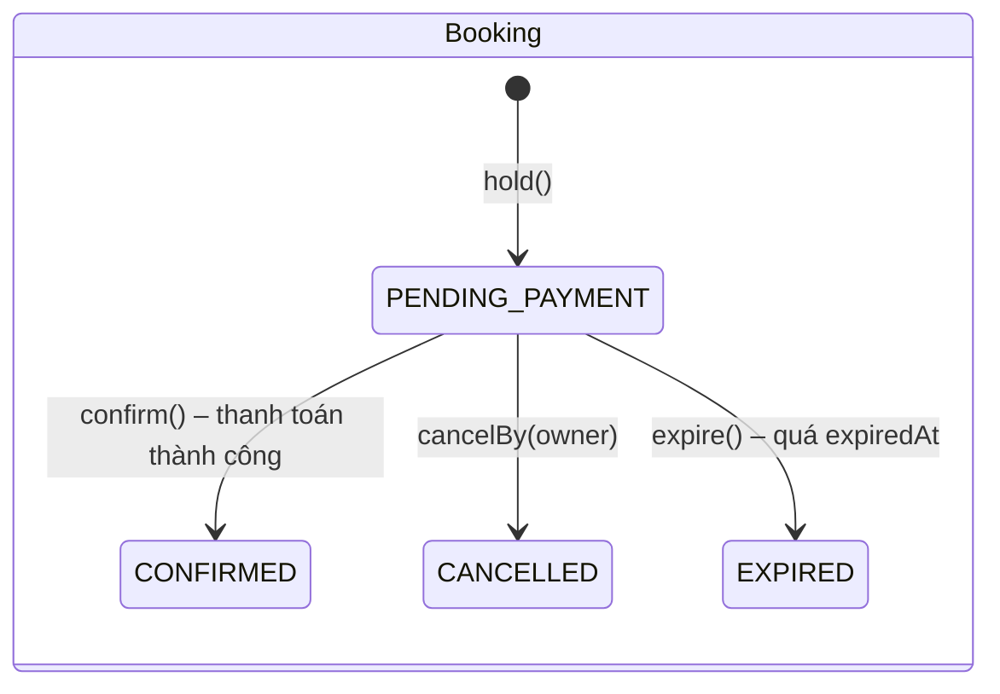
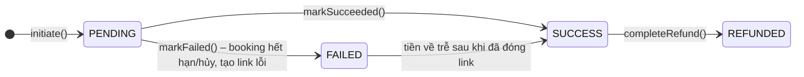
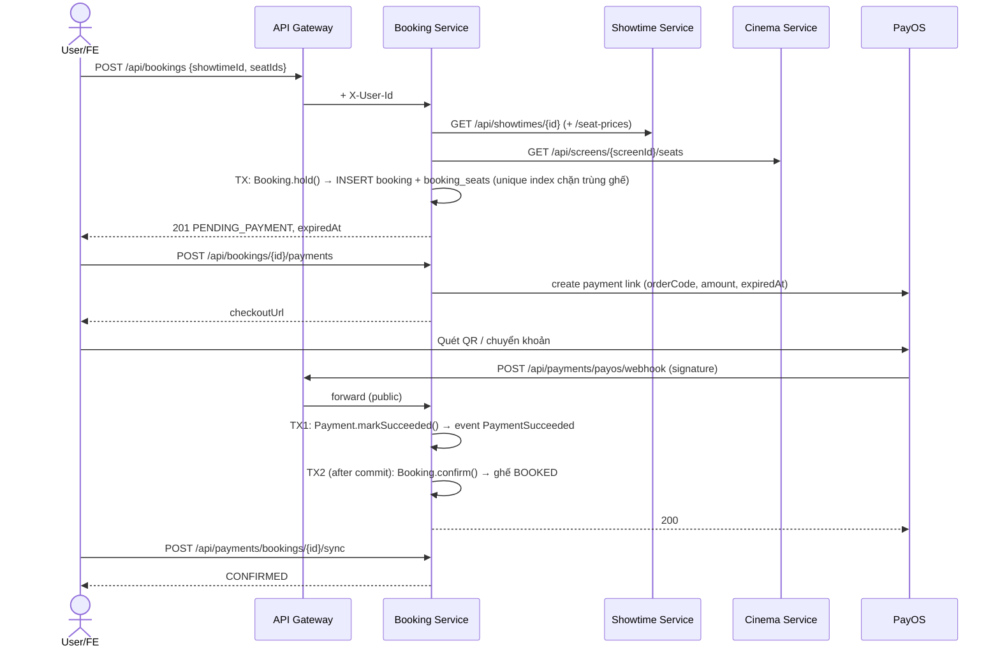

# Booking API

Booking Service giữ ghế theo suất chiếu, tạo booking chờ thanh toán, thanh toán qua **PayOS** và xác nhận / hết hạn / hoàn tiền.
Service được viết theo **Pragmatic DDD** – xem [PRAGMATIC_DDD.md](PRAGMATIC_DDD.md) để hiểu cách tổ chức code.

- Port local: `8085` (`SERVER_PORT`). Qua gateway: `http://localhost:8080`.
- Database: `booking_db` (MySQL, Flyway `V1__init_booking_schema.sql`).
- Mọi response bọc trong `ApiResponse` của module `common` (`status`, `message`, `data`, `timestamp`).
- Định danh người gọi: gateway xác thực JWT rồi gửi header `X-User-Id`, `X-User-Roles`. Gọi thẳng service (không qua gateway) phải tự gửi 2 header này.

## 1. Danh sách endpoint

| Method | Path | Quyền | Mô tả | Thành công |
| --- | --- | --- | --- | --- |
| GET | `/api/bookings/showtimes/{showtimeId}/seats` | Public | Sơ đồ ghế + trạng thái + giá theo suất chiếu | 200 |
| POST | `/api/bookings` | Đăng nhập | Giữ ghế, tạo booking `PENDING_PAYMENT` | 201 + `Location` |
| GET | `/api/bookings/me?page=0&size=10` | Đăng nhập | Lịch sử booking của tôi (mới nhất trước) | 200 |
| GET | `/api/bookings/{id}` | Chủ booking / ADMIN | Chi tiết booking + lần thanh toán gần nhất | 200 |
| POST | `/api/bookings/{id}/cancel` | Chủ booking | Hủy booking đang chờ thanh toán, nhả ghế | 200 |
| POST | `/api/bookings/{id}/payments` | Chủ booking | Tạo (hoặc lấy lại) link thanh toán PayOS | 200 |
| POST | `/api/payments/bookings/{bookingId}/sync` | Chủ booking | Hỏi PayOS trạng thái thật rồi trả booking | 200 |
| POST | `/api/payments/payos/webhook` | Public (verify chữ ký) | PayOS báo kết quả thanh toán | 200 |
| GET | `/api/payments/refunds?status=PENDING` | ADMIN | Danh sách yêu cầu hoàn tiền | 200 |
| POST | `/api/payments/refunds/{id}/complete` | ADMIN | Đánh dấu đã hoàn tiền thủ công | 200 |

### Mã lỗi chung

| HTTP | Khi nào |
| --- | --- |
| 400 | Body/param sai, vi phạm quy tắc domain (`DomainException`: 0 ghế, trùng ghế, quá `BOOKING_MAX_SEATS`, ghế không thuộc phòng...), webhook sai chữ ký |
| 401 | Thiếu / sai `X-User-Id` (chưa đăng nhập) |
| 403 | Endpoint ADMIN nhưng user không có role `ADMIN` |
| 404 | Booking không tồn tại **hoặc không thuộc về bạn** (không lộ id của người khác), showtime không tồn tại |
| 409 | Ghế đã có người giữ/đặt, ghế bảo trì, booking không còn ở trạng thái cho phép (đã hết hạn, đã xác nhận...), suất chiếu đã bắt đầu/bị hủy |
| 502 | PayOS lỗi / chưa cấu hình khi tạo link |
| 503 | showtime-service hoặc cinema-service không phản hồi |

## 2. Chi tiết endpoint

### 2.1 Sơ đồ ghế

`GET /api/bookings/showtimes/{showtimeId}/seats`

Ghép sơ đồ ghế vật lý (cinema-service) với trạng thái ghế thực tế trong `booking_db`.
`status`: `AVAILABLE` | `HELD` (đang có người giữ chờ thanh toán) | `BOOKED` | `UNAVAILABLE` (ghế không `ACTIVE` bên cinema).
Giá = giá theo loại ghế của suất chiếu nếu showtime-service có, ngược lại = `basePrice` của suất chiếu.

```json
{
  "status": 200,
  "message": "Seat map retrieved successfully",
  "data": {
    "showtimeId": 15,
    "screenId": 3,
    "seats": [
      {"seatId": 101, "rowCode": "A", "seatNumber": 1, "seatTypeId": 1, "price": 90000, "status": "AVAILABLE"},
      {"seatId": 102, "rowCode": "A", "seatNumber": 2, "seatTypeId": 2, "price": 150000, "status": "HELD"}
    ]
  }
}
```

### 2.2 Giữ ghế – tạo booking

`POST /api/bookings`

| Field | Kiểu | Ràng buộc |
| --- | --- | --- |
| `showtimeId` | number | bắt buộc, > 0 |
| `seatIds` | number[] | 1..20 phần tử, mỗi id > 0, không trùng; tối đa `BOOKING_MAX_SEATS` (mặc định 8) |

```bash
curl -X POST http://localhost:8080/api/bookings \
  -H "Authorization: Bearer $TOKEN" -H "Content-Type: application/json" \
  -d '{"showtimeId": 15, "seatIds": [101, 102]}'
```

Kiểm tra: suất chiếu phải `SCHEDULED` và chưa bắt đầu; ghế phải thuộc phòng chiếu và `ACTIVE`; ghế chưa bị giữ/đặt.
Booking giữ ghế trong `BOOKING_HOLD_TTL` (mặc định `PT5M`), hết hạn lúc `expiredAt`.

```json
{
  "status": 201,
  "message": "Seats held successfully",
  "data": {
    "id": 12,
    "bookingCode": "BK270120180000X7K2QD",
    "userId": 7,
    "showtimeId": 15,
    "status": "PENDING_PAYMENT",
    "totalAmount": 240000.00,
    "bookingTime": "2027-01-20T18:00:00",
    "expiredAt": "2027-01-20T18:05:00",
    "seats": [
      {"seatId": 101, "price": 90000.00, "status": "HELD"},
      {"seatId": 102, "price": 150000.00, "status": "HELD"}
    ],
    "payment": null
  }
}
```

Lỗi: `409 "One or more selected seats are no longer available"` khi có người giữ ghế trước.

### 2.3 Lịch sử, chi tiết, hủy

- `GET /api/bookings/me?page=0&size=10` – `size` 1..100, trả `PageResponseDTO` (`data.data` là danh sách `BookingView`).
- `GET /api/bookings/{id}` – `BookingView`, trường `payment` là lần thanh toán mới nhất (hoặc `null`).
- `POST /api/bookings/{id}/cancel` – chỉ khi `PENDING_PAYMENT`. Ghế được nhả ngay; link PayOS đang mở bị hủy.

### 2.4 Tạo link thanh toán PayOS

`POST /api/bookings/{id}/payments` (không có body)

- Chỉ khi booking `PENDING_PAYMENT` và chưa quá `expiredAt`.
- Nếu đã có link đang chờ thanh toán → trả lại link cũ (gọi nhiều lần không tạo link mới).
- `orderCode = bookingId * 100 + số lần thử` (tối đa 99 lần), link PayOS hết hạn cùng lúc với booking.

```json
{
  "status": 200,
  "message": "Payment link created successfully",
  "data": {
    "id": 30,
    "bookingId": 12,
    "orderCode": 1201,
    "provider": "PAYOS",
    "amount": 240000.00,
    "status": "PENDING",
    "checkoutUrl": "https://pay.payos.vn/web/2f3a...",
    "paidAt": null
  }
}
```

Frontend redirect người dùng tới `checkoutUrl`. Sau khi PayOS redirect về `PAYOS_RETURN_URL`, **không tin query string** – gọi
`POST /api/payments/bookings/{bookingId}/sync` (hoặc poll `GET /api/bookings/{id}`) để lấy trạng thái thật.

### 2.5 Webhook PayOS

`POST /api/payments/payos/webhook` – PayOS gọi, không có JWT. Service verify `signature` (HMAC-SHA256 bằng `PAYOS_CHECKSUM_KEY`).

- Chữ ký sai → `400`.
- Chữ ký đúng → luôn `200` (kể cả `orderCode` lạ, ví dụ request test khi PayOS xác minh webhook URL).
- Idempotent: PayOS gửi lại nhiều lần không làm thay đổi kết quả.

### 2.6 Hoàn tiền (ADMIN)

PayOS **không có API hoàn tiền** cho link thanh toán, nên hệ thống chỉ tạo yêu cầu `refunds` trạng thái `PENDING`; nhân viên chuyển khoản
trả lại rồi gọi `POST /api/payments/refunds/{id}/complete` → refund `COMPLETED`, payment `REFUNDED`.

## 3. State machine





| Ghế trên sơ đồ | `booking_seats.status` | Ý nghĩa |
| --- | --- | --- |
| `AVAILABLE` | không có dòng active | Có thể chọn |
| `HELD` | `HELD` | Booking `PENDING_PAYMENT` đang giữ |
| `BOOKED` | `BOOKED` | Booking `CONFIRMED` |
| `AVAILABLE` | `RELEASED` | Booking đã hủy/hết hạn, ghế trả lại |

## 4. Luồng nghiệp vụ



Nhánh hết hạn (job chạy mỗi `BOOKING_EXPIRY_SCAN_INTERVAL`, mặc định 30s):

1. Lấy các booking `PENDING_PAYMENT` có `expiredAt <= now`.
2. Hỏi PayOS trạng thái từng link đang mở – nếu thực ra đã `PAID` (webhook bị mất) → đi nhánh thành công.
3. Ngược lại `Booking.expire()` → ghế `RELEASED` → event `BookingExpired` → payment `FAILED` + hủy link PayOS.

Nhánh thanh toán trễ: tiền về sau khi booking đã `EXPIRED`/`CANCELLED` → payment vẫn ghi `SUCCESS` (không mất dấu tiền), booking giữ nguyên,
tạo `refunds` `PENDING` để ADMIN xử lý. Nếu 2 lần thanh toán cùng thành công cho 1 booking, lần sau cũng được đưa vào hoàn tiền.

## 5. Concurrency, idempotency và tính nhất quán

| Vấn đề | Cách xử lý |
| --- | --- |
| 2 người giữ cùng 1 ghế | `booking_seats.active_flag` = 1 khi `HELD`/`BOOKED`, `NULL` khi `RELEASED`; `UNIQUE (showtime_id, seat_id, active_flag)` → insert thứ 2 fail → 409. MySQL cho phép nhiều `NULL` nên lịch sử ghế đã nhả không chặn lần đặt sau. |
| Webhook, job hết hạn, người dùng hủy chạy cùng lúc | Load aggregate bằng `SELECT ... FOR UPDATE` + cột `version` (optimistic lock). |
| PayOS gửi webhook nhiều lần | `markSucceeded()` idempotent; `order_code` unique. |
| 1 transaction = 1 aggregate | Payment và Booking cập nhật ở 2 transaction, nối bằng domain event (`@TransactionalEventListener(AFTER_COMMIT)`). |
| Mất event giữa 2 transaction (crash) | Job định kỳ tìm payment `SUCCESS` có booking chưa `CONFIRMED` và chưa có refund → xử lý lại. |
| Webhook không tới | Job hết hạn + endpoint `sync` chủ động hỏi PayOS. |
| Gọi service khác | Feign gọi **ngoài** transaction DB; timeout 2s/3s; lỗi → 503. |

## 6. Cấu hình

| Biến | Mặc định | Ý nghĩa |
| --- | --- | --- |
| `DB_URL`, `DB_USERNAME`, `DB_PASSWORD` | – | MySQL `booking_db` |
| `EUREKA_URL` | `http://localhost:8761/eureka/` | Discovery |
| `BOOKING_ZONE` | `Asia/Ho_Chi_Minh` | Múi giờ cho `LocalDateTime` |
| `BOOKING_HOLD_TTL` | `PT5M` | Thời gian giữ ghế (tài liệu phân tích đề xuất 2–3 phút; để 5 phút vì chuyển khoản QR cần thêm thời gian) |
| `BOOKING_MAX_SEATS` | `8` | Số ghế tối đa / booking |
| `BOOKING_EXPIRY_SCAN_INTERVAL` | `PT30S` | Chu kỳ job hết hạn + đối soát |
| `BOOKING_EXPIRY_BATCH_SIZE` | `100` | Số booking xử lý mỗi lượt |
| `SHOWTIME_SERVICE_URL`, `CINEMA_SERVICE_URL` | rỗng (dùng Eureka) | Trỏ thẳng URL, ví dụ tới stub khi test |
| `PAYOS_CLIENT_ID`, `PAYOS_API_KEY`, `PAYOS_CHECKSUM_KEY` | rỗng | Lấy ở my.payos.vn. Để trống thì service vẫn chạy, nhưng tạo link trả 502 và webhook trả 400 |
| `PAYOS_RETURN_URL`, `PAYOS_CANCEL_URL` | `http://localhost:5173/payment/result` | Trang FE nhận redirect |

### Test PayOS ở local

1. Tạo kênh thanh toán trên https://my.payos.vn, copy Client ID / API Key / Checksum Key vào `services/booking-service/.env` (không commit).
2. Expose gateway ra internet: `cloudflared tunnel --url http://localhost:8080` (hoặc `ngrok http 8080`).
3. Khai báo webhook URL `https://<tunnel>/api/payments/payos/webhook` trong kênh thanh toán – PayOS gửi request test, service trả 200.
4. Đăng nhập lấy JWT → `POST /api/bookings` → `POST /api/bookings/{id}/payments` → mở `checkoutUrl`, quét QR.
5. Kiểm tra `GET /api/bookings/{id}` = `CONFIRMED`, sơ đồ ghế = `BOOKED`. Để quá TTL mà không trả → `EXPIRED`, ghế về `AVAILABLE`.

### Chạy test

```bash
# Unit + controller test (không cần DB)
./mvnw -pl services/booking-service -am test

# Thêm integration test với MySQL thật
docker run -d --rm --name booking-test-db -p 127.0.0.1:33099:3306 \
  -e MYSQL_DATABASE=booking_test -e MYSQL_USER=booking -e MYSQL_PASSWORD=booking_test \
  -e MYSQL_ROOT_PASSWORD=root mysql:8.0.42
BOOKING_TEST_DB_URL=jdbc:mysql://127.0.0.1:33099/booking_test ./mvnw -pl services/booking-service -am test
```

## 7. Contract cần các service khác cung cấp

Booking gọi qua OpenFeign (`infrastructure/client`). Hai endpoint dưới **chưa tồn tại** – đây là contract đề xuất cho team cinema/showtime.

**Cinema Service** – `GET /api/screens/{screenId}/seats` (bắt buộc để giữ ghế):

```json
{
  "status": 200,
  "data": [
    {"id": 101, "screenId": 3, "rowCode": "A", "seatNumber": 1, "seatTypeId": 1, "status": "ACTIVE"}
  ]
}
```

`status` khác `ACTIVE` (ví dụ `MAINTENANCE`) → ghế hiển thị `UNAVAILABLE`, không giữ được.

**Showtime Service** – `GET /api/showtimes/{id}/seat-prices` (tùy chọn, bảng `showtime_seat_prices` trong ERD):

```json
{
  "status": 200,
  "data": [
    {"id": 77, "seatTypeId": 2, "price": 150000}
  ]
}
```

Nếu endpoint trả 404 (chưa làm) → mọi ghế dùng `basePrice`. `id` được lưu vào `booking_seats.showtime_seat_id`.

Booking cũng dùng `GET /api/showtimes/{id}` hiện có (cần các field `id`, `screenId`, `startTime`, `basePrice`, `status`).

## 8. Schema `booking_db` và điểm khác ERD

Tạo đủ 8 bảng theo ERD: `bookings`, `booking_seats`, `payment_transactions`, `refunds`, `combos`, `booking_combos`, `vouchers`, `user_vouchers`
(combo/voucher mới có schema, chưa có API). Các cột thêm so với ERD và lý do:

| Bảng.cột | Lý do |
| --- | --- |
| `bookings.expired_at` | Thời điểm hết giữ ghế (`ExpiredAt` trong tài liệu phân tích), dùng cho job hết hạn |
| `bookings.version`, `payment_transactions.version` | Optimistic locking (`@Version`) |
| `booking_seats.showtime_id` | Cần cho unique index chống đặt trùng ghế theo suất chiếu |
| `booking_seats.active_flag` (generated) | Chỉ ghế `HELD`/`BOOKED` tham gia unique index |
| `payment_transactions.order_code` | `orderCode` số nguyên PayOS yêu cầu, unique, dùng tra cứu khi nhận webhook |
| `payment_transactions.payment_link_id`, `checkout_url` | Lấy lại link đang mở thay vì tạo link mới |

`payment_transactions.provider_transaction_id` giữ đúng nghĩa ERD: mã giao dịch ngân hàng (`reference`) PayOS trả về khi thanh toán thành công.
