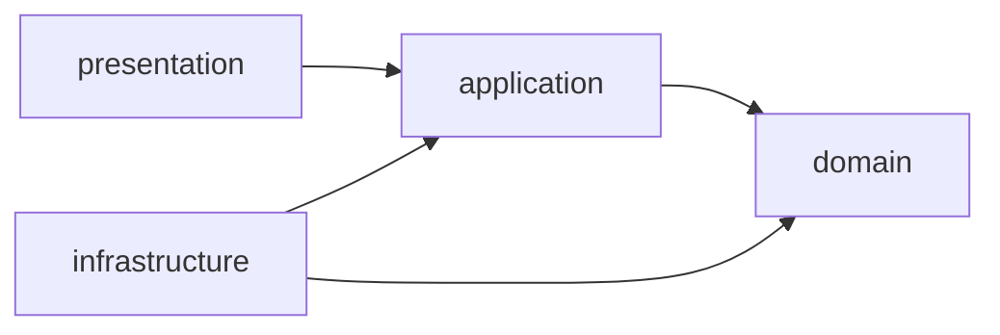

# Pragmatic DDD – Kiến trúc bên trong mỗi service

Tài liệu này mô tả cách team tổ chức code **bên trong một microservice** theo DDD Tactical Design, phiên bản "Pragmatic"
(theo tài liệu môn [02.1_DDD_Tactical_Design_Aggregate_Explained.pdf](02.1_DDD_Tactical_Design_Aggregate_Explained.pdf)).
`booking-service` là service mẫu đầu tiên; các service khác refactor dần theo mục 6.

## 1. Pragmatic DDD là gì, vì sao chọn

| | MVC / Anemic (cũ) | Pragmatic DDD (đang áp dụng) | Hexagonal thuần |
| --- | --- | --- | --- |
| Logic nghiệp vụ nằm ở | `service/` (procedural) | **Aggregate** (entity tự bảo vệ) | Aggregate |
| Entity | `@Getter @Setter`, ai cũng sửa được | `@Entity` nhưng **không setter**, đổi state qua method nghiệp vụ | POJO thuần, JPA entity riêng + mapper |
| Số class | Ít | Vừa phải | Gấp đôi (domain + persistence) |
| Ví dụ trong repo | movie, showtime | **booking** | user |

"Pragmatic" = chấp nhận gắn annotation JPA (`@Entity`, `@Id`, `@Version`...) lên domain model để bớt boilerplate, **nhưng vẫn giữ Rich Model**:
private/protected constructor, static factory, không public setter, invariant kiểm tra trong aggregate.
Đây là cách phổ biến trong dự án Spring Boot thực tế và đúng roadmap "stage 3 – POJO trở thành JPA Entity" của tài liệu môn.

## 2. Cấu trúc package chuẩn

```text
fu.mss301.<service>
├── domain/                 # Trái tim: aggregate, value object, domain event, repository interface
│   ├── shared/             # DomainException, InvalidStateTransitionException
│   └── <aggregate>/        # mỗi aggregate một package: booking/, payment/
│       └── event/          # domain events của aggregate đó
├── application/            # Use case: điều phối, KHÔNG chứa quy tắc nghiệp vụ
│   ├── port/               # interface tới hệ thống ngoài (service khác, payment gateway)
│   ├── <use-case group>/   # booking/, payment/ ... + View (DTO đầu ra)
│   ├── policy/             # lắng nghe domain event → cập nhật aggregate khác
│   └── exception/          # lỗi tầng ứng dụng (upstream, gateway...)
├── infrastructure/         # Chi tiết kỹ thuật, có thể thay thế
│   ├── persistence/        # Spring Data JPA + adapter implement repository của domain
│   ├── client/             # Feign client + adapter implement port
│   ├── payos/              # SDK bên thứ ba + adapter
│   ├── config/             # @ConfigurationProperties, bean cấu hình
│   └── scheduling/         # @Scheduled job (chỉ gọi use case)
└── presentation/           # REST
    ├── controller/
    ├── dto/                # request body (+ Bean Validation)
    ├── security/           # đọc X-User-Id / X-User-Roles từ gateway
    └── exception/          # map exception → HTTP status
```

### Quy tắc phụ thuộc



| Tầng | Được dùng | Không được dùng |
| --- | --- | --- |
| `domain` | JPA annotation, Lombok `@Getter`, `AbstractAggregateRoot` của Spring Data | Spring Web, Feign, SDK bên thứ ba, DTO, `ApiException`/HTTP status |
| `application` | `domain`, `port`, `TransactionRunner`, `ApiException` cho 404/403 | Feign client, Spring Data repository trực tiếp, SDK PayOS |
| `infrastructure` | Mọi thứ kỹ thuật; implement interface của `domain`/`application` | Chứa quy tắc nghiệp vụ |
| `presentation` | `application` (use case, view) | Repository, entity setter, gọi Feign |

## 3. Building blocks – ví dụ thật trong booking-service

### 3.1 Aggregate Root

`domain/booking/Booking.java` – một booking và các ghế của nó là **một khối nhất quán**.

```java
@Entity
@Table(name = "bookings")
@Getter
@NoArgsConstructor(access = AccessLevel.PROTECTED)          // chỉ JPA dùng
public class Booking extends AbstractAggregateRoot<Booking> {
    // ... fields, không có @Setter

    public static Booking hold(Integer userId, Long showtimeId, List<SeatSelection> selections, int maxSeats,
                               LocalDateTime now, Duration holdTtl) {
        if (selections == null || selections.isEmpty()) throw new DomainException("At least one seat is required");
        if (selections.size() > maxSeats) throw new DomainException("A booking can hold at most " + maxSeats + " seats");
        // ... tính totalAmount, status = PENDING_PAYMENT, expiredAt = now + ttl
    }

    public void confirm(LocalDateTime now) {
        requirePending("confirm");                            // invariant nằm trong root
        status = BookingStatus.CONFIRMED;
        seats.forEach(seat -> seat.book(now));
        registerEvent(new BookingConfirmed(id));
    }
}
```

Hỏi 3 câu để biết có phải Aggregate Root không: có identity riêng? bên ngoài tìm trực tiếp theo id? có quy tắc cần bảo vệ?
→ `Booking` và `PaymentTransaction` đều "có" cả 3.

### 3.2 Entity con

`BookingSeat` (con của `Booking`), `Refund` (con của `PaymentTransaction`):

- Constructor/factory và method đổi state để **package-private** (`static BookingSeat hold(...)`, `void book(...)`) → chỉ root gọi được.
- Root trả danh sách con dạng `Collections.unmodifiableList(...)`.
- **Không có repository riêng** cho entity con; lưu qua `bookingRepository.save(booking)` (cascade).

### 3.3 Value Object

Bất biến, không identity, tự validate khi tạo – dùng `record`:

```java
public record SeatSelection(Integer seatId, Integer showtimeSeatId, BigDecimal price) {
    public SeatSelection {
        if (seatId == null || seatId <= 0) throw new DomainException("Seat id must be positive");
        // price >= 0, tối đa 2 chữ số thập phân
    }
}

@Embeddable
public record BookingCode(@Column(name = "booking_code") String value) {
    public static BookingCode generate(LocalDateTime now) { ... }
}
```

### 3.4 Repository

Interface nằm ở **domain**, nói bằng ngôn ngữ nghiệp vụ; implement ở **infrastructure**:

```java
// domain/booking/BookingRepository.java
public interface BookingRepository {
    Booking save(Booking booking);
    Optional<Booking> findByIdForUpdate(Integer id);   // SELECT ... FOR UPDATE
    List<Integer> findOverdueIds(LocalDateTime now, int limit);
}

// infrastructure/persistence/JpaBookingRepository.java
@Repository
class JpaBookingRepository implements BookingRepository {
    private final BookingJpaRepository jpa;             // Spring Data, package-private
    public Booking save(Booking booking) { return jpa.save(booking); }   // publish domain events
}
```

### 3.5 Domain Event + Policy

Aggregate ghi nhận event bằng `registerEvent(...)`; Spring Data publish khi `save()`. Policy ở application nghe **sau khi commit**
và cập nhật aggregate khác trong transaction mới:

```java
@TransactionalEventListener(phase = TransactionPhase.AFTER_COMMIT)
public void on(PaymentSucceeded event) {
    settlement.settle(event.paymentId(), event.bookingId());   // Booking.confirm() trong TX riêng
}
```

### 3.6 Use case (Application Service)

Chỉ điều phối: load → gọi method của aggregate → save. Không `if (status == ...)` nghiệp vụ ở đây.

```java
public BookingView cancel(Integer userId, Integer bookingId) {
    return tx.call(() -> {
        var booking = bookings.findByIdForUpdate(bookingId).filter(b -> b.isOwnedBy(userId))
            .orElseThrow(() -> new ApiException(HttpStatus.NOT_FOUND, "Booking not found"));
        booking.cancelBy(userId, LocalDateTime.now(clock));    // quy tắc nằm trong Booking
        return BookingView.of(bookings.save(booking), null);
    });
}
```

`TransactionRunner` (`application/TransactionRunner.java`) bọc `TransactionTemplate` để mỗi lần gọi = 1 transaction = 1 aggregate,
và để gọi Feign/PayOS **ngoài** transaction.

### 3.7 Port + Adapter (Anti-corruption layer)

Use case không biết Feign hay SDK PayOS – chỉ biết interface:

| Port (application) | Adapter (infrastructure) | Hệ thống ngoài |
| --- | --- | --- |
| `ShowtimeCatalog` | `client/ShowtimeCatalogAdapter` + `ShowtimeClient` | showtime-service |
| `SeatLayoutProvider` | `client/SeatLayoutAdapter` + `CinemaClient` | cinema-service |
| `PaymentGateway` | `payos/PayosPaymentGateway` | PayOS SDK |

Lợi ích: đổi PayOS sang VNPay chỉ viết adapter mới; test dùng `@MockitoBean PaymentGateway`.

## 4. Quy tắc vàng (checklist khi review PR)

- [ ] **1 transaction = 1 aggregate.** Cần đổi aggregate khác → domain event + policy.
- [ ] Entity **không có `@Setter`**; state đổi qua method có tên nghiệp vụ (`confirm()`, `expire()`, `cancelBy()`).
- [ ] Tạo aggregate qua **static factory** (`Booking.hold(...)`), constructor `protected`/`private`.
- [ ] Invariant kiểm tra **trong aggregate**, vi phạm → `DomainException` (400) / `InvalidStateTransitionException` (409).
- [ ] Không repository cho entity con; luôn `rootRepository.save(root)`.
- [ ] Aggregate khác tham chiếu **bằng id** (`PaymentTransaction.bookingId`), không `@ManyToOne` sang aggregate khác.
- [ ] Gọi service khác / bên thứ ba **ngoài** transaction DB.
- [ ] Thời gian lấy từ `Clock` bean, truyền `now` vào method domain (dễ test).
- [ ] Controller không gọi repository; map exception → HTTP ở `presentation/exception`.
- [ ] Unit test aggregate không cần Spring (`BookingTest`, `PaymentTransactionTest`).

## 5. Lỗi thường gặp

| Sai | Đúng |
| --- | --- |
| `booking.setStatus(CONFIRMED)` trong service | `booking.confirm(now)` |
| `bookingSeatRepository.save(seat)` | `booking` sửa seat qua method của root rồi `bookingRepository.save(booking)` |
| Một `@Transactional` vừa `payment.markSucceeded()` vừa `booking.confirm()` | Payment TX → event `PaymentSucceeded` → policy → Booking TX |
| Gọi `showtimeClient` trong `@Transactional` | Gọi trước, sau đó mới mở transaction |
| Domain import `FeignException`, `HttpStatus` | Domain chỉ ném `DomainException`; presentation map sang HTTP |

## 6. Hướng dẫn refactor service MVC sang Pragmatic DDD

### 6.1 Mapping thư mục

| MVC hiện tại | Pragmatic DDD |
| --- | --- |
| `entity/Xxx.java` | `domain/<aggregate>/Xxx.java` (bỏ setter, thêm method nghiệp vụ) |
| `enums/` | `domain/<aggregate>/` (cạnh aggregate dùng nó) |
| `repository/XxxRepository` (Spring Data) | `domain/<aggregate>/XxxRepository` (interface) + `infrastructure/persistence/` (Spring Data + adapter) |
| `service/` + `service/impl/` | `application/<group>/XxxUseCase` – logic nghiệp vụ chuyển **vào aggregate** |
| `client/` | `application/port/` (interface) + `infrastructure/client/` (Feign + adapter) |
| `controller/`, `dto/` | `presentation/controller/`, `presentation/dto/`; DTO đầu ra → `application/.../XxxView` |
| `config/` | `infrastructure/config/` |
| `exception/` | `domain/shared/` (lỗi nghiệp vụ), `application/exception/`, `presentation/exception/` (handler) |

### 6.2 Các bước an toàn (mỗi bước một PR nhỏ, test xanh sau mỗi bước)

1. **Viết test** cho hành vi hiện tại (controller/service test) nếu chưa có.
2. **Bỏ `@Setter`** khỏi entity, compile để thấy mọi chỗ đang set trực tiếp.
3. Với mỗi chỗ set, **tạo method nghiệp vụ** trên entity và chuyển `if` kiểm tra từ service vào method đó.
4. Thay constructor rỗng bằng `@NoArgsConstructor(access = PROTECTED)` + **static factory** cho việc tạo mới.
5. **Tách use case**: service lớn → các class `XxxUseCase` nhỏ chỉ load → gọi method → save.
6. **Di chuyển package** theo bảng 6.1 (IDE refactor → move), tạo interface repository ở domain + adapter.
7. Đưa client sang port/adapter; cập nhật `STRUCTURE.md` trạng thái service.

### 6.3 Ví dụ: `Showtime` (showtime-service)

Hiện tại (minh hoạ, **chưa sửa code**):

```java
@Entity @Getter @Setter @NoArgsConstructor
public class Showtime { private ShowtimeStatus status; private LocalDateTime startTime; ... }

// ShowtimeServiceImpl
private void requireEditable(Showtime showtime) {
    if (showtime.getStatus() == ShowtimeStatus.CANCELLED || !showtime.getStartTime().isAfter(LocalDateTime.now(clock))) {
        throw new ShowtimeConflictException("Cancelled or started showtimes cannot be changed");
    }
}
showtime.setStatus(ShowtimeStatus.CANCELLED);
```

Sau refactor:

```java
@Entity @Getter @NoArgsConstructor(access = AccessLevel.PROTECTED)
public class Showtime {
    public static Showtime schedule(Integer movieId, Integer screenId, LocalDateTime start, LocalDateTime end,
                                    BigDecimal basePrice, LocalDateTime now) { ... validate ... }

    public void cancel(LocalDateTime now) {
        requireEditable(now);
        status = ShowtimeStatus.CANCELLED;
        updatedAt = now;
    }

    private void requireEditable(LocalDateTime now) {
        if (status == ShowtimeStatus.CANCELLED || !startTime.isAfter(now)) {
            throw new InvalidStateTransitionException("Cancelled or started showtimes cannot be changed");
        }
    }
}

// application/CancelShowtimeUseCase
public ShowtimeView cancel(Long id) {
    var showtime = showtimes.findByIdForUpdate(id).orElseThrow(...);
    showtime.cancel(LocalDateTime.now(clock));
    return ShowtimeView.of(showtimes.save(showtime));
}
```

### 6.4 Ghi chú về user-service

user-service đang theo **Hexagonal thuần** (domain model tách khỏi JPA entity, có `port/in`, `port/out`, mapper). Cách này tương thích với
Pragmatic DDD (cùng tinh thần domain ở trung tâm) nên **không bắt buộc đổi**; chỉ cần tuân thủ checklist mục 4 khi thêm tính năng mới.
